# Art Hackathon — Card Stack

### 검색 결과를 3D 카드로 쌓고, 고른 페이지를 조각으로 분해하는 웹 작품

**검색어 하나가 카드 스택이 되고, 고른 페이지는 조각이 되고, 고른 조각은 다시 검색어가 됩니다.**

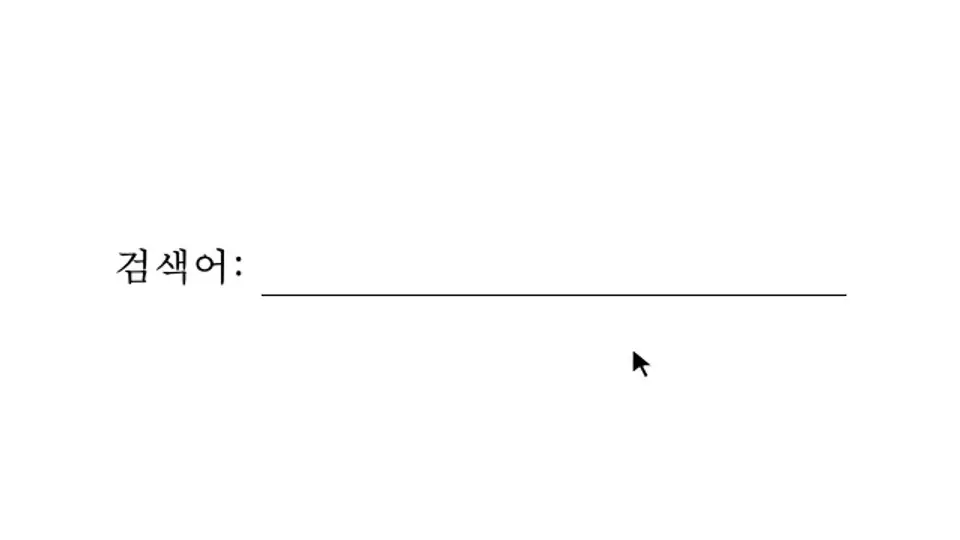

<sub>실제 화면 · 실제 검색(미디어 아트), 카드 18장 · 입력 구간은 크게 잘라 냄 · 대기 5.3초를 약 1초로 줄이고 카드 등장은 2.2배속 · 끝의 확대는 같은 화면을 이어 녹화 · 커서는 녹화용으로 덧그림</sub>

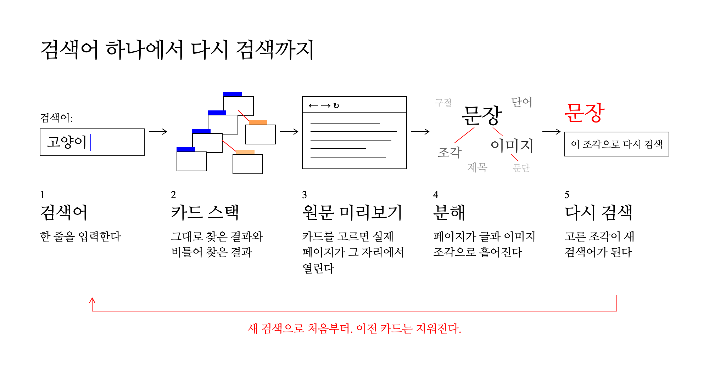

<sub>2026 오픈 프롬프트 커뮤니티 예술 해커톤 · 주제: 휴먼 인 더 루프(Human in the Loop), AI의 답에 인간의 질문을 더하기 · 2026년 11월 5–7일, 아트코리아랩 6층 아고라</sub>

[1 검색](#1-검색-한-검색어-두-갈래) · [2 카드 스택](#2-카드-스택) · [3 미리보기](#3-원문-미리보기) · [4 분해](#4-분해) · [5 보기](#5-세-가지-보기) · [6 조각](#6-조각-다루기) · [7 계산](#7-계산) · [8 구조와 API](#8-구조와-api) · [9 실행](#9-실행) · [10 한계와 문서](#10-한계와-문서) · [11 작업 과정](#11-작업-과정)

---

## 1. 검색: 한 검색어, 두 갈래


<sub>설명용 모션 · 코드로 그린 개념도이며 실제 화면이 아님 · 검색어와 제목은 녹화된 고양이 검색 응답 예시에서 옮김 · good 10장 중 5장만 그리고, 좌우로 퍼지는 awesome 카드를 한 축에 모아 단순화</sub>

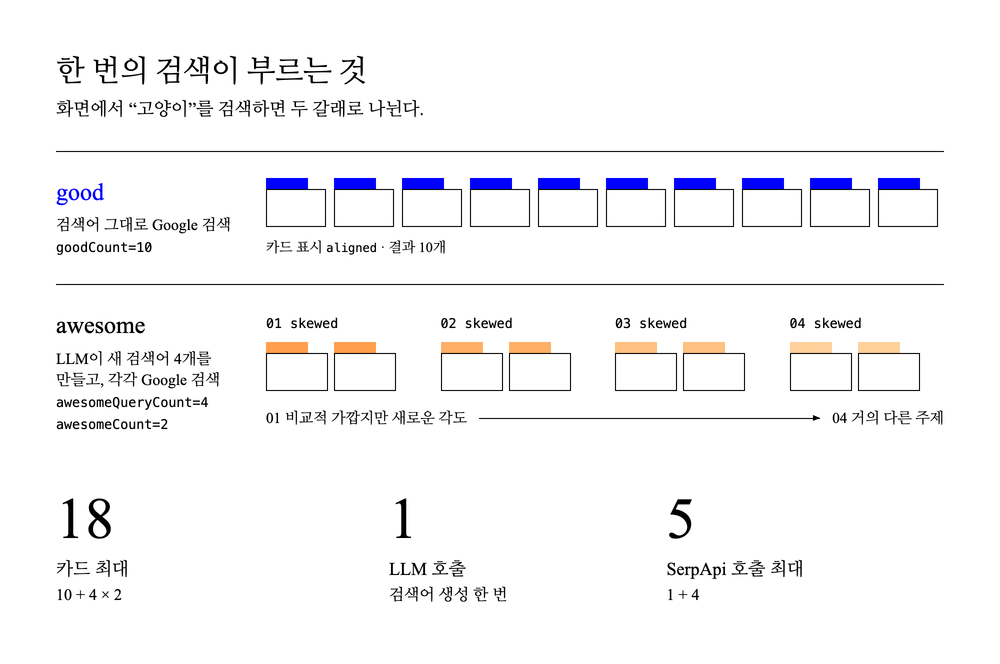

<sub>awesome 1–4순위는 LLM이 정한 탐색 순서입니다. 측정한 점수가 아니고, Google 문서 순위와도 별개입니다.</sub>

<details>
<summary>검색 동작 자세히</summary>

- good은 입력한 검색어 그대로의 Google 결과입니다.
- awesome은 LLM이 검색어와 재해석 방향으로 새 검색어를 만들고, 그 검색어로 다시 찾은 결과입니다. 재해석 방향은 준비된 20개 중 요청마다 하나를 무작위로 고릅니다.
- 실제 `GET /search`를 사용합니다. 검색마다 유료 외부 API를 호출합니다.
- SerpApi 설정은 `hl=ko`, `gl=kr`, `tbs=li:1`(Verbatim), `no_cache=true`이고, 동시 요청은 최대 5개입니다.
- good과 검색어 생성은 병렬로 시작합니다. 검색어 생성은 한 번만 호출하며, 실패하면 502를 돌려주고 재시도나 다른 공급자로 대체하지 않습니다.
- LLM 기본 공급자는 Anthropic(`claude-opus-5-5`)이고, `LLM_PROVIDER=openai`이면 OpenAI(`gpt-6.1-sol`)를 씁니다.
- 순위는 두 가지입니다. `awesome[검색어].rank`는 검색어 순위이고, `results[i].rank`는 Google 문서 순위 $(page-1) \cdot 10 + position$ 입니다.
- 새 검색이나 화면 종료 때 이전 요청을 취소하며, 서버도 연결이 끊어진 요청의 외부 작업을 취소합니다.
- 서버 시간 제한은 120초이고, 그때까지 모인 부분 결과를 200으로 돌려줍니다. 클라이언트 제한은 122초입니다.
- 오류, 빈 결과, 부분 결과를 그대로 표시하고 목데이터로 대체하지 않습니다. 화면 문구는 `검색 API 오류 (N)`, 검색 요청이 중단되었습니다. 다시 검색해주세요., 검색 결과가 없습니다 입니다.

</details>

## 2. 카드 스택

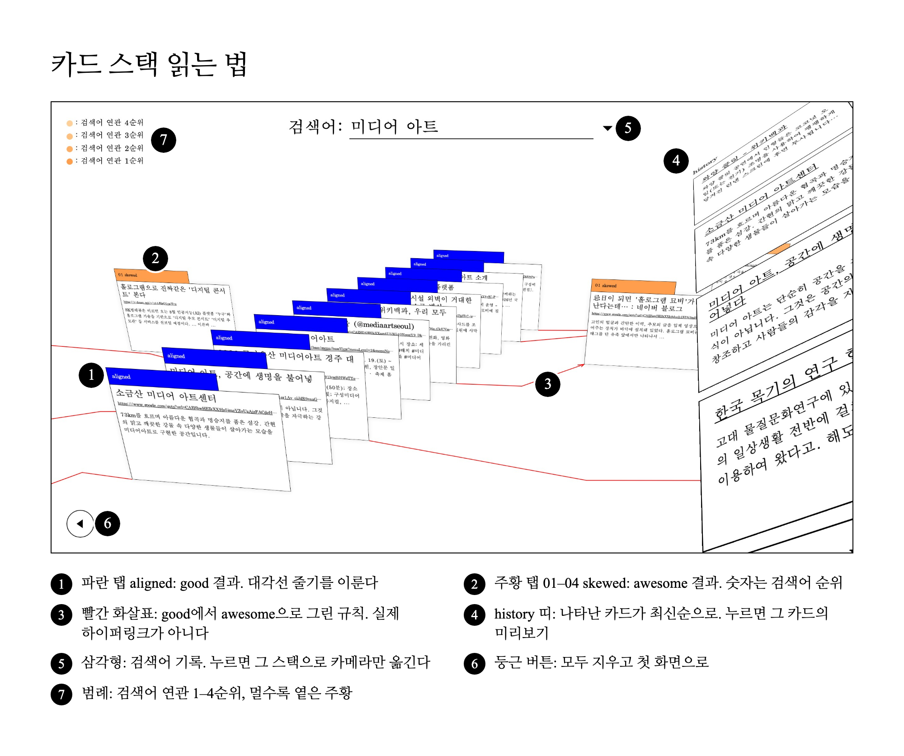

<sub>실제 화면에 번호를 덧붙임 · 실제 검색(미디어 아트)</sub>

<details>
<summary>조작, 검색 이어가기, 검색어 기록</summary>

**조작**: 드래그는 이동, 휠은 확대, 빈 곳 더블클릭은 전체 보기, 포커스된 카드에서 Enter는 선택입니다. history 띠는 휠이나 드래그로 넘깁니다. 카드는 850 ms 간격으로 하나씩 나타나고, 카메라가 최신 카드를 따라간 뒤 마지막에 전체를 보여 줍니다. 카드에는 제목, URL, 설명만 있고 이미지는 그리지 않습니다.

**검색 이어가기**: 카드를 고르면 되돌아가기, 분해, 검색 이어가기 버튼이 나옵니다. 검색 이어가기는 그 카드의 제목(없으면 도메인)을 새 검색어로 씁니다. 기존 카드, 위치, 히스토리는 그대로 두고 새 스택을 붙입니다. [설명용 모션](#1-검색-한-검색어-두-갈래)의 끝부분이 이 동작입니다.

**검색어 기록**: 검색과 이어가기마다 기록이 한 줄씩 늘어납니다. 기록을 누르면 새로 검색하지 않고 그 스택으로 카메라만 옮깁니다. 기록과 히스토리는 메모리에만 있어 새로고침하면 사라지고, 새 최초 검색을 하면 이전 기록과 카드가 지워집니다.

</details>

## 3. 원문 미리보기

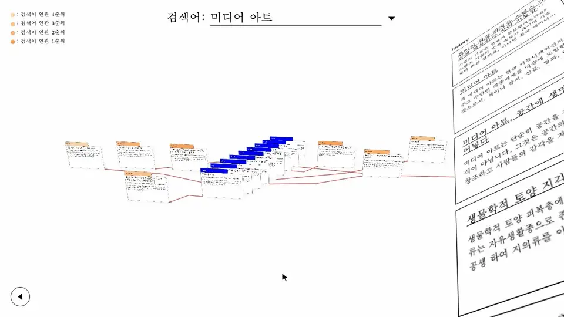

<sub>실제 화면 · 실제 원격 브라우저 · 서버의 Chrome 화면을 캔버스로 받고 입력을 그대로 보냄 · 이미 주소가 풀린 카드를 다시 연 장면이며, 첫 프레임 전 0.5초의 검은 화면과 대기 구간을 잘라냄 · 1.15배속</sub>

<details>
<summary>미리보기 동작 자세히</summary>

- 서버의 시스템 Chrome 화면을 앱 안 캔버스로 받아 그리고, 마우스, 휠, 키 입력을 그대로 보냅니다. 새 탭으로 열리는 링크(`target="_blank"`, `window.open`)와 오른쪽 히스토리 클릭도 이 창 안에서 이동합니다.
- 기본 경로는 WebSocket `/preview-ws?url&w&h&dpr`입니다. 시스템 Chrome(`--headless=new`, `CHROME_BIN` 또는 알려진 경로)을 CDP로 움직이고, `Page.startScreencast`의 JPEG(품질 82)를 캔버스에 그립니다.
- 세션은 최대 6개이고, 넘으면 가장 오래된 세션을 닫습니다. 캔버스는 너비 320–1920, 높이 240–1200, dpr 1–2로 제한합니다.
- 첫 프레임 전에 WebSocket이 실패하거나(`ws_error`, `ws_closed_before_frame`, `invalid_ws_url`) 서버가 오류를 보내면(`browser_unavailable`, `unsafe_url`, `missing_url`) `GET /preview?mode=inspect&url=`로 넘어갑니다. 서버에 Chrome이 없을 때가 `browser_unavailable`입니다. 결과는 셋 중 하나입니다.
  - `iframe`: 직접 임베드. YouTube 임베드 포함. sandbox는 `allow-scripts allow-same-origin allow-forms`
  - `proxy`: `/preview?url=`로 정리한 HTML. CSP `script-src 'none'`, sandbox `allow-same-origin`, 512 KB 제한, 보이는 글자 120자 이상 필요
  - `fallback`: 앱 안 요약 카드 "앱 내 문서 요약 보기". 사유는 `http_N`, `non_html`, `client_only_shell`, `upstream_unreachable`
- Google 리다이렉트 URL(`/goto`, `/url`)을 풀고, `assertSafePublicUrl`로 SSRF를 검사합니다.
- 미리보기 바깥을 누르면 닫힙니다. 분해 중에는 닫지 않습니다.

</details>

## 4. 분해

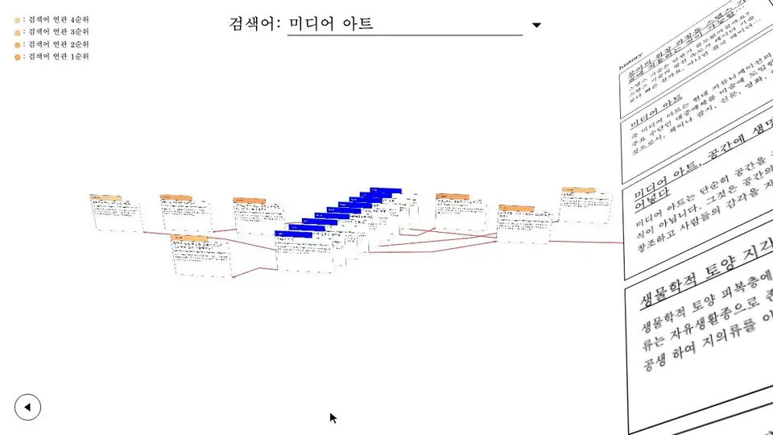

<sub>실제 화면 · 실제 분해 응답 · 첫 유료 요청 장면(대기 18.4초를 약 2초로 줄임)과 같은 페이지의 캐시 재진입 장면을 로딩이 끝나는 순간에 이어 붙임 · 페이지가 그려지기 전 검은 프레임을 빼고, 조각이 자리 잡는 3.3초는 3배속</sub>

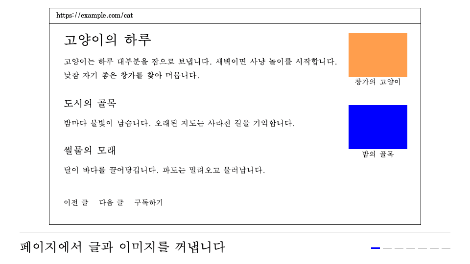

<sub>설명용 모션 · 코드로 그린 개념도이며 실제 화면이 아님 · 예시 페이지와 유사도 값은 지어낸 것이고, 식과 상수(1024차원, 0.14, 0.72)만 실제 코드 값</sub>

<details>
<summary>분해 동작, 기준 검색어, 오류</summary>

- 처음에는 읽는 순서로 0.5초에 걸쳐 퍼지고, 2.2초 뒤 저절로 상호 유사도로 바뀝니다. 그 전에 조각을 드래그하거나 누르면 바뀌지 않습니다. 움직임 줄이기 설정이면 바로 상호 유사도로 엽니다.
- 조각은 사각형 없이 글자와 이미지만 표시합니다. 입력한 검색어와 비슷할수록 진하고 큽니다. 계산은 [7절](#7-계산)에 있습니다.
- 대기 중에는 취소할 수 있습니다. 같은 URL과 검색어는 새로고침 전까지 최근 8개를 다시 요청하지 않습니다.
- 페이지당 약 0.01–0.05달러, 보통 8–21초가 듭니다(문서 기록).
- 조립 버튼이나 Esc는 조각을 가운데로 모아 같은 미리보기로 돌아갑니다. 페이지를 다시 불러오지 않습니다. 조각을 선택한 상태의 Esc는 선택만 해제합니다.

기준 검색어는 입력한 검색어이거나, 마지막으로 이어간 검색어이거나, 검색어 기록에서 옮겨 간 검색어입니다. awesome 카드에서도 LLM이 만든 검색어가 아니라 이 검색어를 씁니다. 눌러 본 카드의 스택을 따라가지 않으며, 200자로 잘라 보냅니다.

오류는 버튼 옆에 한국어로 표시하고 미리보기는 그대로 둡니다. 응답 형식은 `{error:{code,message}}`입니다.

| 상태 | 코드 |
| --- | --- |
| 400 | `INVALID_URL`, `INVALID_TEXT` |
| 403 | `BLOCKED_URL` |
| 405 | `METHOD_NOT_ALLOWED`(프록시) |
| 413 | `PAGE_TOO_LARGE` |
| 415 | `UNSUPPORTED_CONTENT` |
| 422 | `EMPTY_CONTENT` |
| 500 | `INTERNAL` |
| 502 | `DNS_FAILED`, `FETCH_FAILED`, `UPSTREAM_STATUS`, `DECONSTRUCT_UNAVAILABLE`(프록시) |
| 503 | `BUSY`, `EMBEDDING_FAILED` |
| 504 | `PAGE_TIMEOUT` |

</details>

## 5. 세 가지 보기

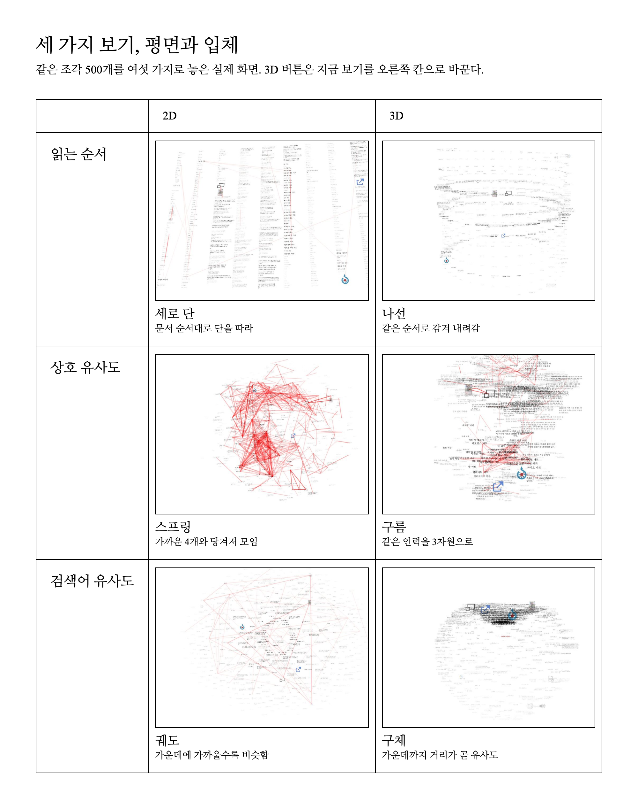

<sub>실제 화면, 위키백과 미디어 아트 페이지의 조각 500개 · 칸마다 연결 상위 값이 다름</sub>


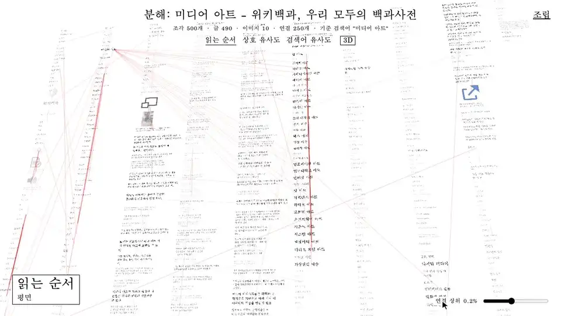

<sub>실제 화면 · 실제 분해 응답 · 왼쪽 아래 이름표는 녹화용으로 덧붙임 · 위 1.5배속, 아래 1.3배속 · 커서가 조각을 지날 때의 강조는 녹화에서 끔</sub>

### 읽는 순서

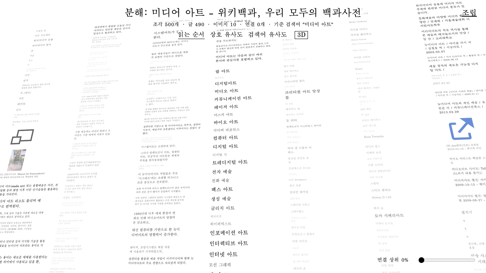

### 상호 유사도

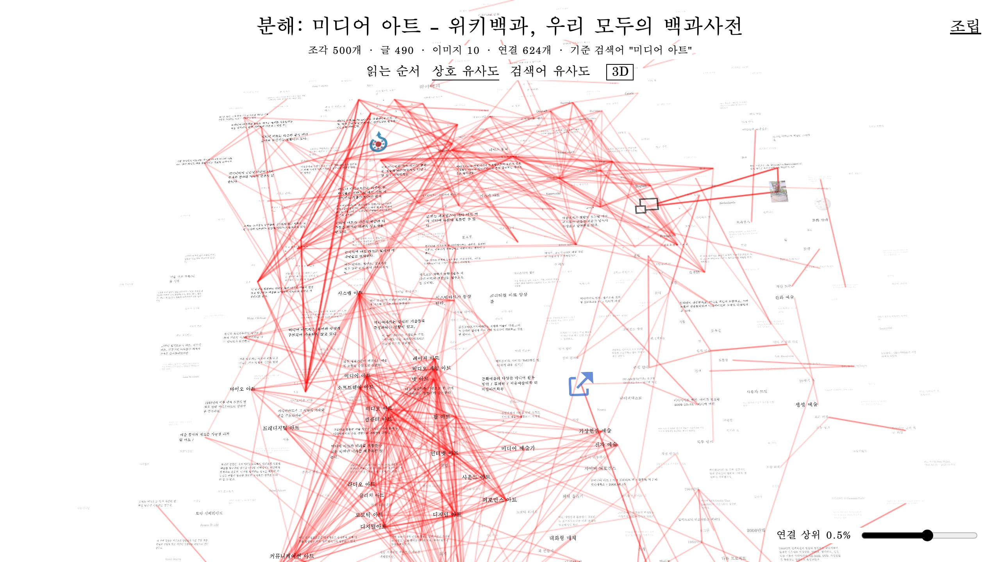

<sub>빨간 선은 가중치가 높은 쌍입니다. "연결 상위" 기본값은 0%이고, 조각을 고르거나 올리면 가까운 조각 최대 5개로 선이 나타납니다.</sub>

### 검색어 유사도

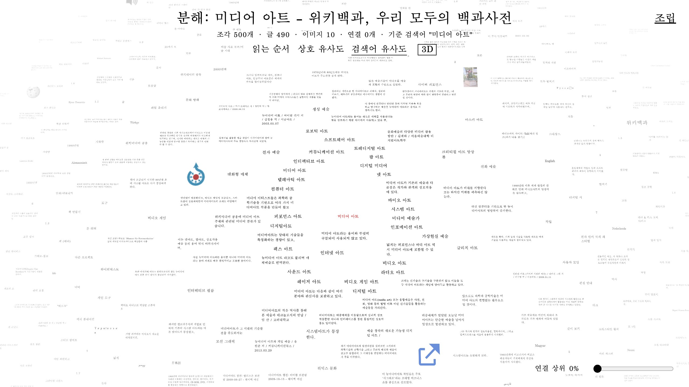

### 3D

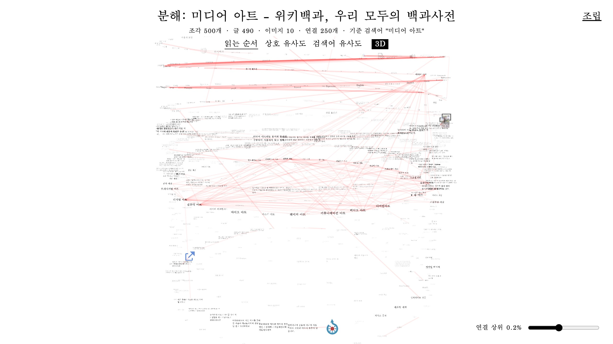

<details>
<summary>보기 조작</summary>

평면에서 드래그는 이동, 3D에서 드래그는 회전이고, 휠은 확대입니다. 처음에는 살짝 확대되어 열리고(0.68), 빈 곳 더블클릭은 전체 보기입니다. 3D는 드래그하거나 조각을 고르기 전까지 천천히 돕니다. 검색어 유사도는 유사도 값이 있을 때만 나타나고, 가운데에 검색어가 붉은 글자로 놓입니다.

</details>

## 6. 조각 다루기

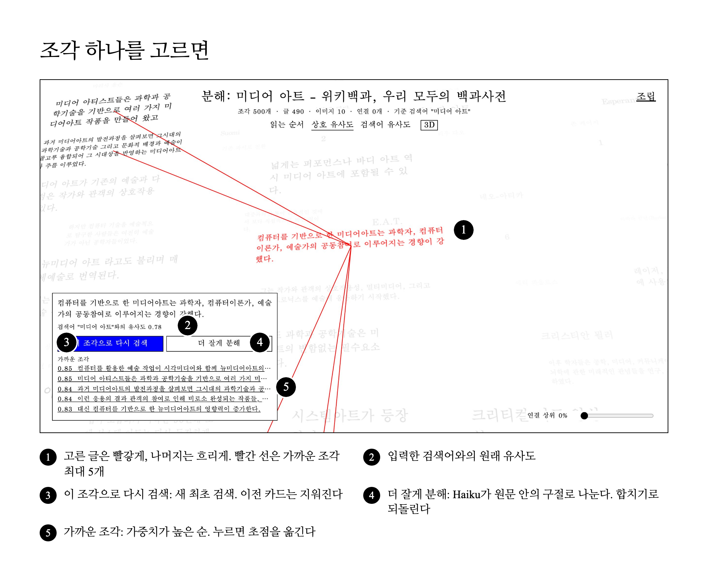

<sub>실제 화면에 번호를 덧붙임</sub>

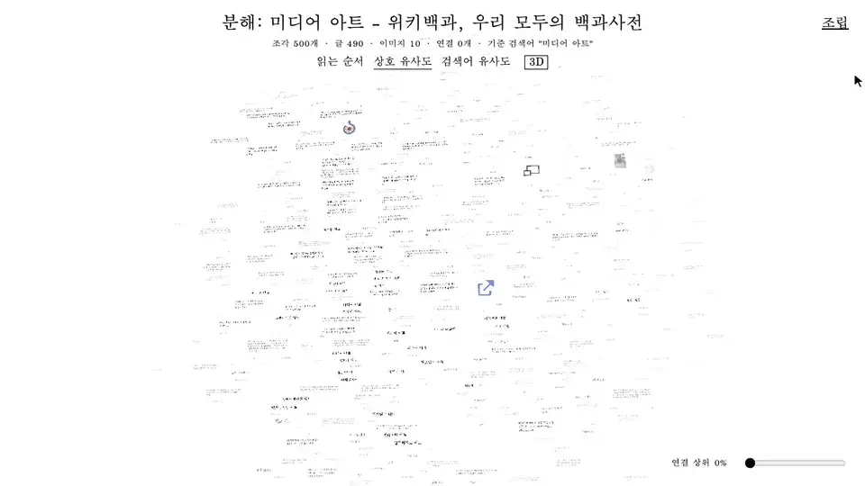

<sub>실제 화면 · 실제 Haiku 호출과 실제 검색 · 대기 17.5초를 약 2초로 줄이고 새 카드 등장은 3.2배속</sub>

<details>
<summary>다시 검색과 구절 나누기 자세히</summary>

- 다시 검색은 그 글을 새 최초 검색어로 삼습니다. 이미지는 `label`을, 없으면 가장 가까운 글 조각을 씁니다. 공백을 정리하고 단어 경계에서 100자로 자릅니다.
- 구절 나누기는 Claude Haiku(`claude-haiku-5-5`)로 원문 순서대로 겹치지 않는 구절을 받습니다. 원문에 실제로 있는 부분만 통과합니다. 호출당 약 0.00005달러입니다.
- `GET /deconstruct/phrases?text=&query=`, 글은 1000자까지, 구절은 최대 8개입니다. 모델은 `REFINE_MODEL`로 바꿀 수 있습니다.
- 호출이 실패하거나, 지출 한도에 닿거나, `SEGMENT_MODE=rule`이면 규칙으로(문장 부호, 없으면 단어) 나누고 화면에 표시합니다. 상태 문구는 구절로 나누는 중입니다, 규칙으로 나눴습니다, 더 나눌 구절이 없습니다 입니다.
- 원문이 6자 미만이면 더 잘게 분해 버튼을 숨깁니다. 원래 문장으로 합치기는 나누기 전으로 되돌립니다.
- 글 조각은 그 자리에서 구절로 바뀝니다. 이미지는 그대로 두고 `label`을 나눈 구절을 아래에 모읍니다.
- 구절의 크기와 진하기는 자기 검색어 유사도를 원래 페이지 척도로 계산한 값입니다. 가까운 조각 목록은 원래 문장의 것을 물려받습니다. 구절끼리의 가중치는 계산하지 않습니다.
- 구절도 다시 검색하거나 또 나눌 수 있고, 보기와 3D를 바꿔도 부모를 따라갑니다.

</details>

## 7. 계산

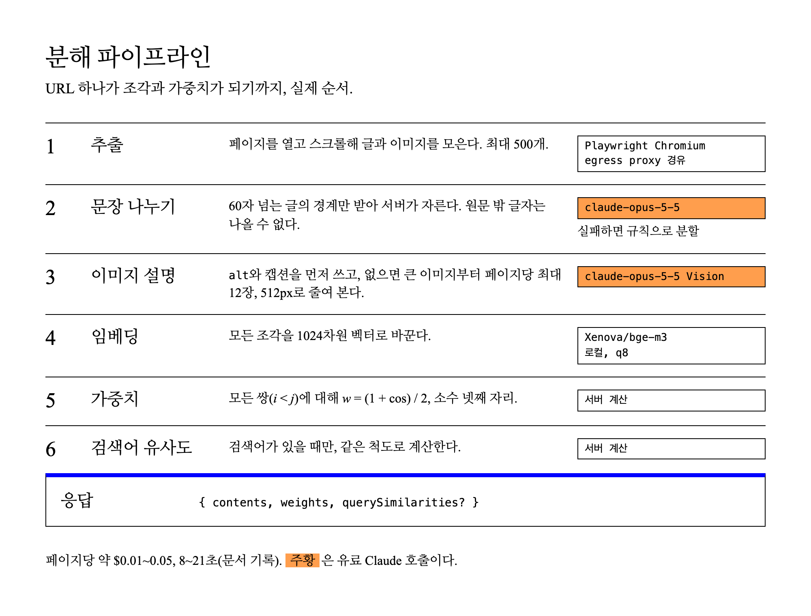

모든 쌍($i \lt j$)의 가중치입니다. 값이 대략 0.53–1에 몰려서, 빨간 선은 상위 백분위로 고릅니다.

$$
w_{ij} = \frac{1 + \cos(e_i, e_j)}{2}
$$

빨간 선 개수입니다. $N$ 은 쌍의 수 $n(n-1)/2$ 이고, $p$ 는 "연결 상위" 퍼센트($p \gt 0$)입니다.

$$
\mathrm{threads} = \max\left(1, \min\left(4000, N, \left\lceil \frac{N p}{100} \right\rceil\right)\right)
$$

진하기와 크기는 가중치가 아니라 조각의 검색어 유사도 $v$ 만 따릅니다. $v$ 도 $(1 + \cos)/2$ 척도이고, 페이지마다 정렬해 5% 지점을 $low$, 95% 지점을 $high$ 로 잡습니다.

$$
t = \mathrm{clamp}\left(\frac{v - low}{high - low}, 0, 1\right)
$$

불투명도는 $\epsilon = 0.14$ 아래로 내려가지 않습니다.

$$
\mathrm{opacity} = \epsilon + (1 - \epsilon) t
$$

크기 배율은 0.72에서 1.72 사이입니다.

$$
\mathrm{scale} = 0.72 + t
$$

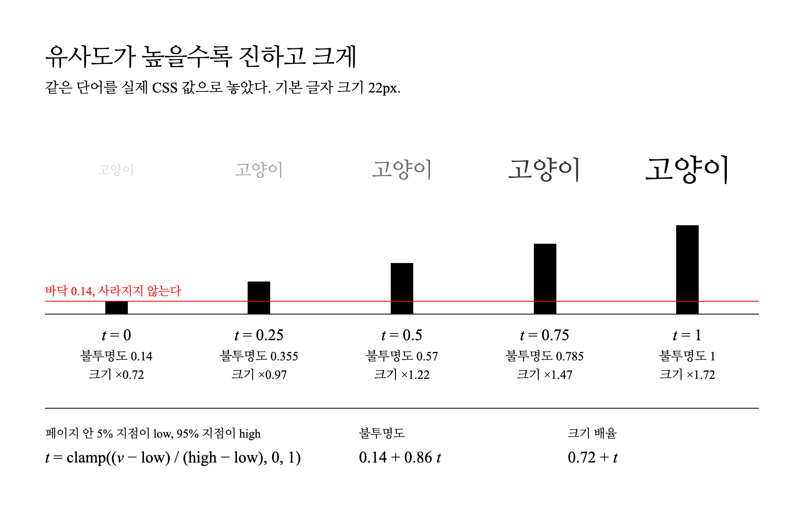

<sub>실제 코드의 상수로 계산해 그린 그림 · 앱 화면 캡처가 아님</sub>

<details>
<summary>표시 값 자세히</summary>

가중치는 소수 넷째 자리까지 돌려주고, 길이는 $n(n-1)/2$ 입니다.

패널에는 늘리기 전의 원래 유사도를 소수 둘째 자리까지 표시합니다. 유사도가 없으면 불투명도와 크기는 1입니다.

- 이미지는 `alt`, 캡션, `aria-label`, `title`을 먼저 씁니다. SVG, 64px 미만, 한도를 넘는 이미지는 주변 글자를 쓰고, 단색 이미지는 뺍니다.
- 임베딩 모델 `Xenova/bge-m3`는 첫 실행 때 약 560MB를 내려받고 메모리를 1.2–1.8GB 씁니다.
- 응답은 `{contents:[{type:"text"|"img",content,label?}], weights:[[i,j,w]], querySimilarities?}`입니다.
- 기본 글상자: 이미지 200x150, 14자 이하 글 너비 200·글자 22, 48자 이하 너비 260·글자 17, 그보다 길면 너비 340·글자 14·최대 6줄입니다.
- 선택하거나 올리면 다른 조각은 불투명도 $\times 0.16$ 으로 낮아지고, 선택한 조각과 가까운 조각은 1이 되며, 선택한 글은 빨강이 됩니다.
- 슬라이더 단계는 0, 0.05, 0.1, 0.2, 0.5, 1, 2, 5 퍼센트입니다.
- 선의 투명도와 굵기는 표시 범위 안에서 늘린 강도 $s$ 를 따릅니다. 투명도는 $(0.28 + 0.6 s) \cdot threadAlpha$, 굵기는 $1 + 0.5 s$ 입니다.

</details>

## 8. 구조와 API

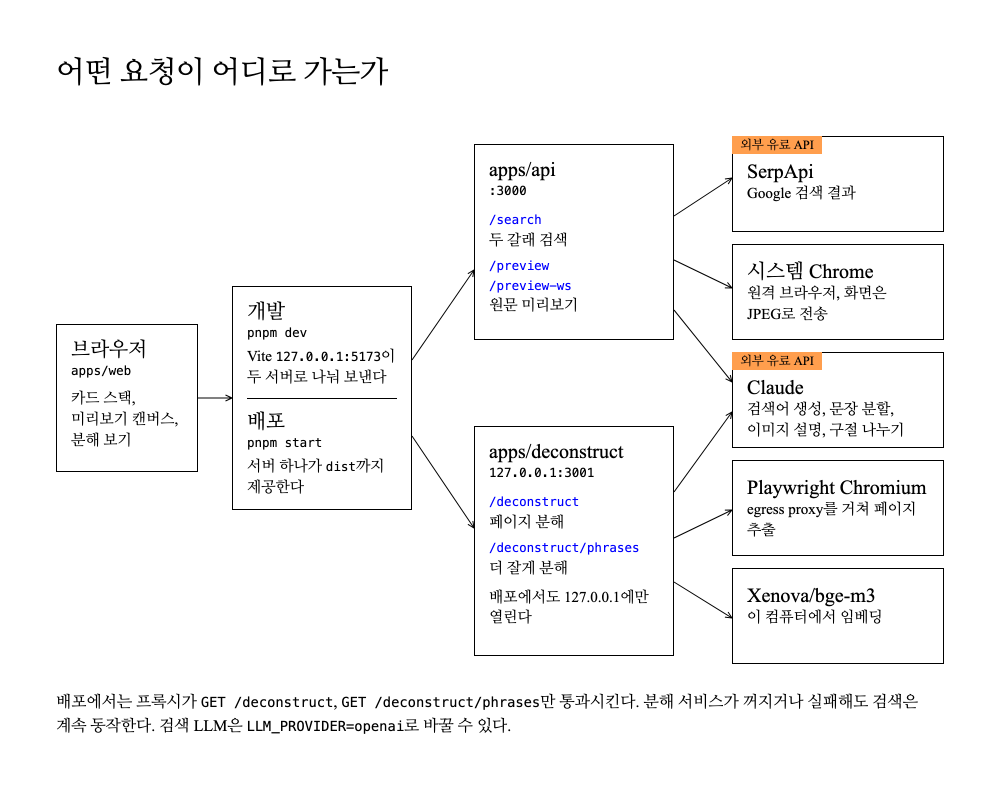

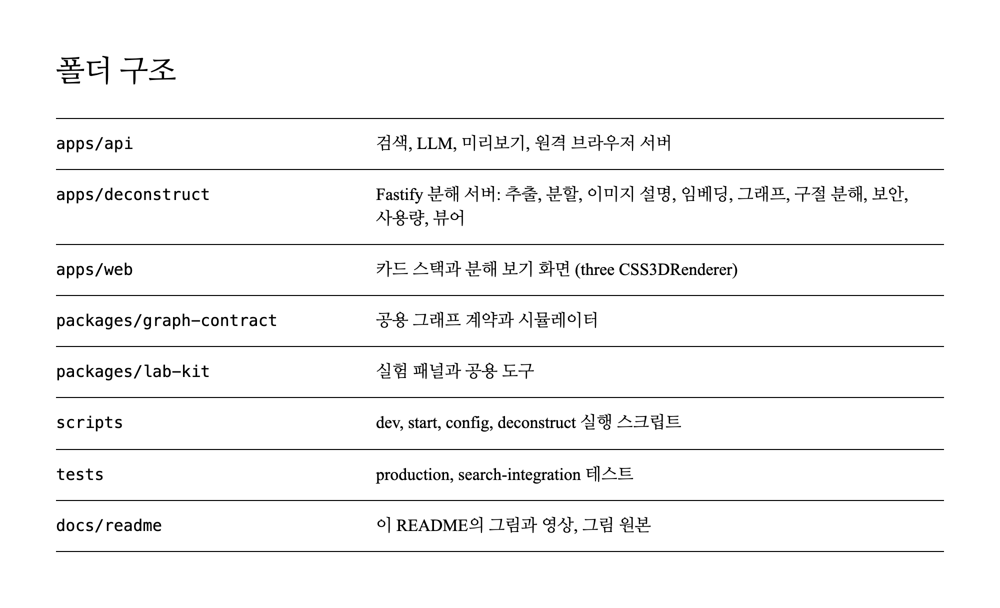

### 검색 API

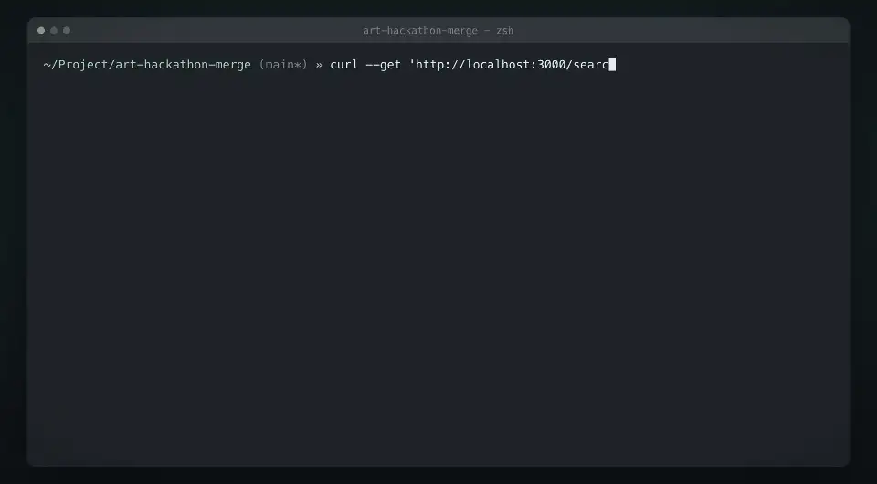

<sub>실제 터미널 녹화(팀원 제공) · 개인 프롬프트가 보이는 맨 앞 0.4초를 잘라 내고 타이핑 1.6배속, 대기 3배속 · **영상의 이름은 지금 API와 다릅니다.** 아래 표의 현재 이름을 쓰세요</sub>

| 영상 속 이름 | 현재 코드의 이름 | 기본값 | 범위 |
| --- | --- | --- | --- |
| `skewedQueryCount` | `awesomeQueryCount` | 10 | 0–20 |
| `skewedCount` | `awesomeCount`(검색어 하나당) | 3 | 0–100 |
| `alignedCount` | `goodCount` | 30 | 0–100 |
| 응답 키 `aligned` | 응답 키 `good` | | |
| 응답 키 `skewed` | 응답 키 `awesome` | | |

<details>
<summary>현재 이름으로 쓴 요청, 검색 API 오류, 서버 구성</summary>

`aligned`와 `skewed`는 지금 카드 탭의 표시 글자로만 남아 있습니다. 서버는 모르는 파라미터를 거부하지 않으므로, 영상의 명령을 그대로 보내면 기본값이 적용될 것입니다(코드를 읽어 추론, 실행해 보지 않음).

영상과 같은 요청을 현재 이름으로 쓰면 다음과 같습니다. 실행할 때마다 유료 API를 호출합니다.

```bash
curl --get 'http://localhost:3000/search' \
  --data-urlencode 'query=고양이' \
  --data-urlencode 'awesomeQueryCount=4' \
  --data-urlencode 'awesomeCount=4' \
  --data-urlencode 'goodCount=10' | jq
```

화면은 `goodCount=10`, `awesomeQueryCount=4`, `awesomeCount=2`로 요청합니다. `awesomeDirection`으로 재해석 방향을 직접 줄 수도 있습니다.

`/search` 오류:

| 상태 | 메시지 |
| --- | --- |
| 400 | `query is required`, 개수 관련 메시지 |
| 404 | `Not found` |
| 405 | `Method not allowed` |
| 502 | `LLM query generation failed`, `SerpApi search failed` |

- 개발 서버는 `/search`, `/preview`, `/preview-ws`를 API로, `/deconstruct`를 분해 서버로 프록시합니다.
- 프로덕션 서버는 빌드 화면과 생성된 assets를 제공하고, 127.0.0.1에만 열린 분해 서버의 `GET /deconstruct`와 `/deconstruct/phrases`만 프록시합니다. 그래서 공개 포트에서 `/health`와 `/debug/extract`는 404입니다.
- 분해 서버는 `NODE_ENV=production`으로 돌며, 이때 뷰어와 `/debug/extract`를 등록하지 않습니다. `/health`는 127.0.0.1:3001에서 그대로 응답합니다.
- 서버 생성 함수의 선택적 `frontendDir` 옵션을 생략하면 기존 API 진단 화면(`apps/api/public`)을 유지합니다.
- `dist`는 Git에서 제외합니다.
- `art-hackathon-query-api`의 검색 API와 `algorithm_team2/prototypes/06-card-stack` 화면을 통합한 독립 프로젝트입니다. 원본 저장소의 코드는 변경하지 않습니다.

</details>

상세 규약: [API_SPEC](apps/api/API_SPEC.md) · [분해 API 연동 가이드](apps/deconstruct/FRONTEND.md) · [분해 서버 README](apps/deconstruct/README.md)

## 9. 실행

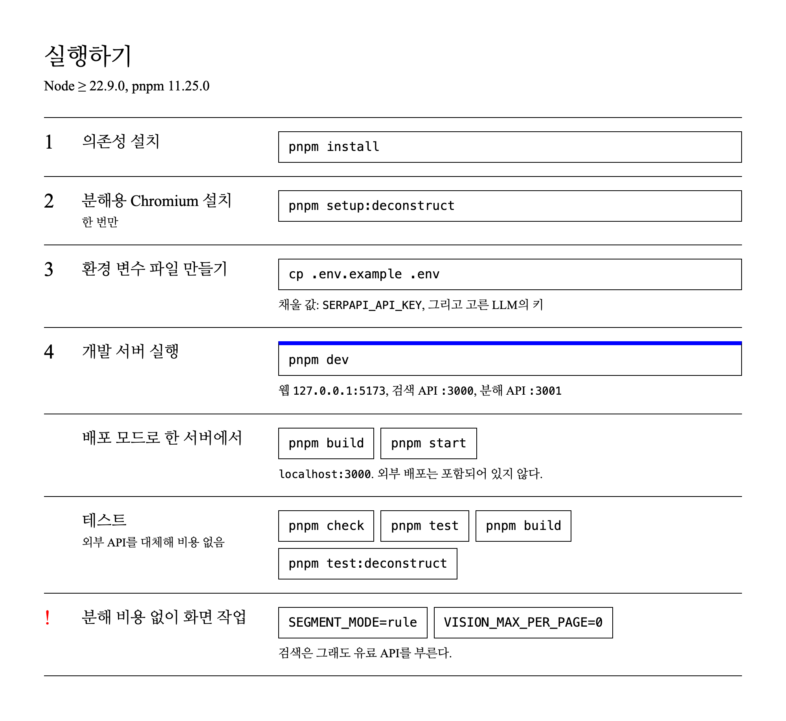

```bash
pnpm install
```

```bash
pnpm setup:deconstruct   # 분해에 쓰는 Chromium 설치. 최초 1회
```

```bash
cp .env.example .env     # SERPAPI_API_KEY와 선택한 LLM 공급자의 API 키를 입력
```

```bash
pnpm dev
```

분해 서버는 메모리를 1.2–1.8GB 쓰고, 첫 실행 때 임베딩 모델 약 560MB를 내려받습니다. 필요 없으면 `DECONSTRUCT_ENABLED=false`로 끕니다.

<details>
<summary>프로덕션과 검증</summary>

개발 화면: http://127.0.0.1:5173 · 검색 API: http://127.0.0.1:3000 · 분해 API: http://127.0.0.1:3001

프로덕션:

```bash
pnpm build
```

```bash
pnpm start
```

http://localhost:3000 에서 카드 스택과 API를 같은 서버로 제공합니다. 빌드가 없으면 실행 안내와 함께 종료합니다. 외부 배포는 포함하지 않습니다.

검증:

```bash
pnpm check
```

```bash
pnpm test
```

```bash
pnpm build
```

```bash
pnpm test:deconstruct   # 분해 서버 테스트. Chromium 필요
```

테스트는 외부 API를 대체하며 실제 비용을 발생시키지 않습니다. 목데이터는 명시적인 격리 테스트나 `apiEndpoint: ''`로 지정한 테스트 마운트에서만 사용합니다. 기록은 [VERIFICATION.md](VERIFICATION.md)에 있습니다.

</details>

<details>
<summary>환경 변수와 비용</summary>

키는 서버에서만 읽으며 Git과 프론트 빌드에서 제외됩니다. 환경 설정을 변경하면 서버를 재시작합니다. 최초 구성 때는 기존 API 프로젝트의 환경 설정을 루트 `.env`에 복사했습니다.

| 변수 | 뜻 |
| --- | --- |
| `SERPAPI_API_KEY` | 필수. Google 검색 |
| `ANTHROPIC_API_KEY` | `LLM_PROVIDER=anthropic`(기본)일 때 필수 |
| `OPENAI_API_KEY` | `LLM_PROVIDER=openai`일 때 필수 |
| `LLM_PROVIDER` | `anthropic` 또는 `openai` |
| `ANTHROPIC_MODEL`, `OPENAI_MODEL` | 공급자별 모델 |
| `PORT` | API, 프로덕션 포트. 기본 3000 |
| `WEB_PORT` | 개발 화면 포트. 기본 5173 |
| `DECONSTRUCT_ENABLED` | `false`면 분해 서버를 끕니다. 꺼져 있거나 실패해도 검색은 그대로 동작합니다 |
| `DECONSTRUCT_PORT` | 분해 서버 포트. 기본 3001 |
| `SEGMENT_MODE` | `rule`이면 문장 나누기와 구절 나누기를 규칙으로 합니다 |
| `VISION_MAX_PER_PAGE` | 페이지당 Vision 이미지 수. 기본 12 |
| `LLM_BUDGET_USD` | 분해 지출 한도. 기본 100달러 |
| `REFINE_MODEL` | 구절 나누기 모델. 기본 `claude-haiku-5-5` |
| `CHROME_BIN` | 미리보기에 쓸 Chrome 경로 |
| `CORS_ORIGIN` | CORS 허용 출처 |

그 밖의 한도는 [`apps/deconstruct/src/config.js`](apps/deconstruct/src/config.js)에 있습니다.

- 화면 작업 중에는 루트 `.env`에 `SEGMENT_MODE=rule`과 `VISION_MAX_PER_PAGE=0`을 넣으면 분해 LLM 비용 없이 같은 형식으로 응답합니다. 검색은 그래도 유료 API를 부릅니다.
- 지출 한도는 머신별로 `apps/deconstruct/data/usage.json`에 쌓는 추정치이고, 조금 넘을 수 있으며, `/search`의 LLM 비용은 포함하지 않습니다.
- 장부 단가는 백만 토큰당 달러로 입력/출력 Opus 4/20, Sonnet 2/10, Haiku 0.1/0.5입니다.
- 검색 한 번의 비용은 문서에 기록되어 있지 않습니다.
- `pnpm dev` 터미널에는 `/search` 요청 검색어와 옵션, 응답 상태와 소요 시간, good 문서 순위와 제목, awesome 생성 검색어와 순위, 각 문서 순위와 제목이 표시됩니다. 요청 번호로 요청과 응답을 연결하며 URL, 이미지, 본문은 출력하지 않습니다. `pnpm start`에서는 이 로그를 출력하지 않습니다.

</details>

## 10. 한계와 문서

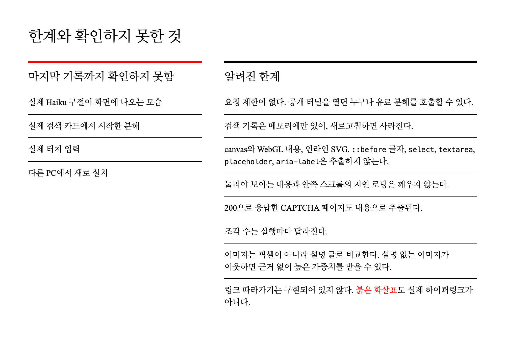

<sub>왼쪽은 VERIFICATION.md 마지막 기록 기준입니다. 이 README를 촬영하면서 앞의 두 항목은 실제 응답으로 동작을 봤고, 뒤의 두 항목은 여전히 확인하지 못했습니다.</sub>

<details>
<summary>촬영하며 본 문제</summary>

- 공개 터널로 열면 누구나 유료 분해를 호출할 수 있습니다. 서버에는 아직 요청 빈도 제한이 없고, 지출은 `LLM_BUDGET_USD`에서 멈춥니다.
- Google `/goto` 카드를 처음 열면 원격 브라우저가 "요청 확인 중" 중간 페이지에 머물 수 있습니다(촬영 때 약 10초 지속, 다음 열기에서는 바로 열림). 이때 분해하면 중간 페이지를 추출할 가능성이 있습니다(코드를 읽어 추론, 실행해 보지 않음).
- 조각에는 페이지의 메뉴와 아이콘도 포함됩니다. 위키백과 미디어 아트 페이지는 500개 상한에 닿았습니다.
- 언어 이름 조각의 키릴 문자 일부(и)가 빈 네모로 나왔습니다(촬영 환경의 헤드리스 Chromium). 다른 환경에서 같은지는 확인하지 않았습니다.

</details>

<details>
<summary>기록된 검증과 성능</summary>

- 테스트, README 촬영 때 다시 실행(커밋 21f6492 기준): API·production 102, web·shared 108, deconstruct 97 모두 통과. [VERIFICATION.md](VERIFICATION.md)의 2026-11-07 main 병합 기록에는 web·shared가 104입니다.
- 성능, 2026-11-07 3차 검증 기록: 조각 500개, 개발 PC Chromium에서 터짐, 3D, 회전 120fps(가장 느린 프레임 9 ms), 평면 복귀 117fps(가장 느린 프레임 67 ms). 이 값은 전환을 바꾼 4차 변경 전의 측정입니다.
- 검색 이어가기, 2026-11-06 통합 검증 기록: 카드 17장에서 35장으로 늘어도 기존 17장의 ID와 위치가 유지됨.

</details>

<details>
<summary>이 README의 그림과 영상</summary>

- 그림 원본: [`docs/readme/src/figures.html`](docs/readme/src/figures.html), 그림에 쓴 화면 사진은 [`docs/readme/src/raw`](docs/readme/src/raw)
- 설명용 모션 원본: [`motion_concept.html`](docs/readme/src/motion_concept.html), [`motion_deconstruct.html`](docs/readme/src/motion_deconstruct.html)
- 실제 화면 영상과 사진은 2026-11-07에 실제 검색과 실제 분해 응답으로 찍었습니다. 카드에 나오는 내용은 그때의 공개 검색 결과입니다.
- `process_concept`, `process_archive`는 팀 아카이브를, `process_board`는 피그마 보드를 캡처했습니다.

모션 렌더:

```bash
node docs/readme/src/render-motion.mjs <html> <output.webp> --lossless
```

</details>

문서: [API_SPEC](apps/api/API_SPEC.md) · [분해 API 연동 가이드](apps/deconstruct/FRONTEND.md) · [분해 서버 README](apps/deconstruct/README.md) · [검증 기록](VERIFICATION.md)

## 11. 작업 과정

**[팀 아카이브 열기](https://claude.ai/artifact/5tuAr4eDBKamX1oaWJu8Jy)**: 회의 녹음과 전사, 직접 눌러 보는 개념 시연

<a href="https://claude.ai/artifact/5tuAr4eDBKamX1oaWJu8Jy">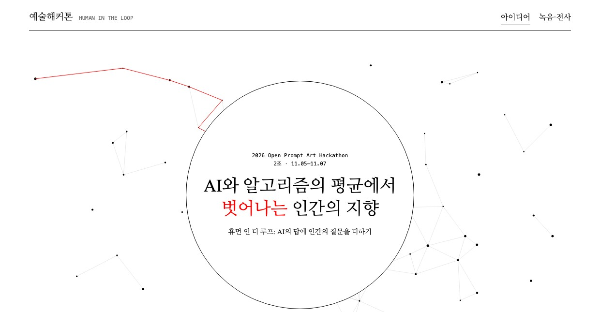</a>

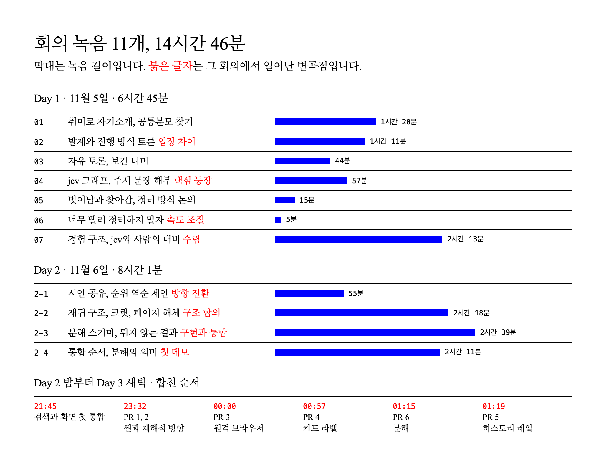

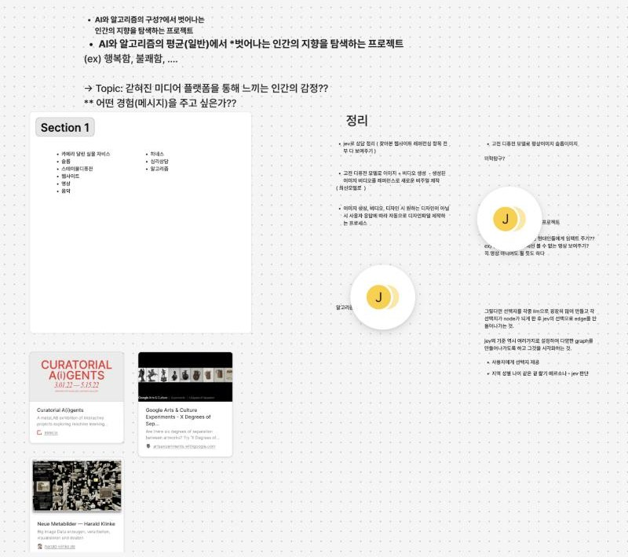

<sub>Day 1 · 피그마 보드</sub>

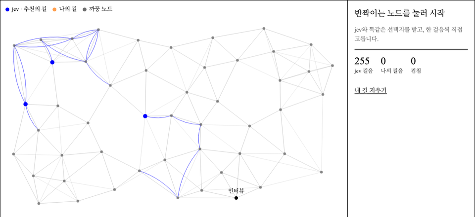

<sub>Day 1 안 · jev의 빠른 길과 사람의 느린 길 · 아카이브의 개념 시연, 단어는 예시</sub>

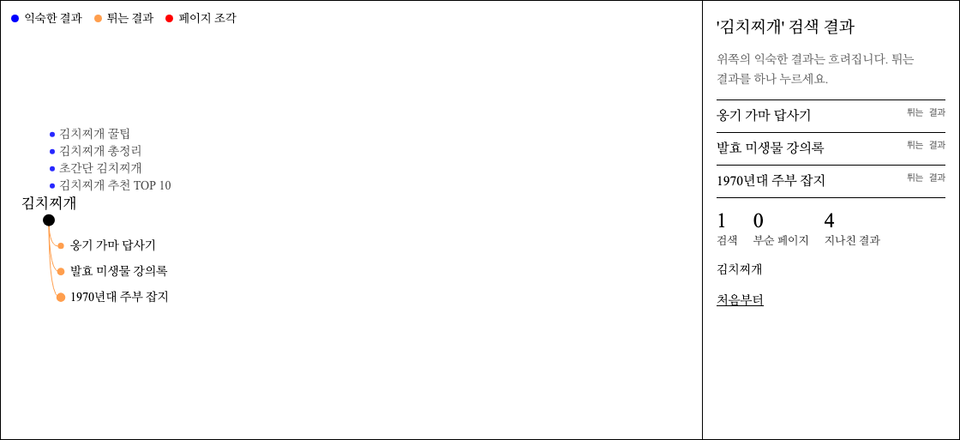

<sub>Day 2 오후 안 · 튀는 결과를 부수고 조각에서 다시 검색 · 아카이브의 개념 시연, 단어는 예시</sub>

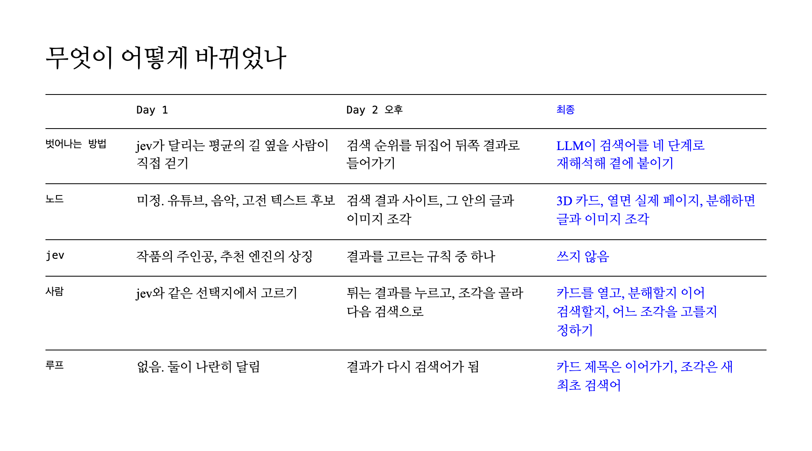

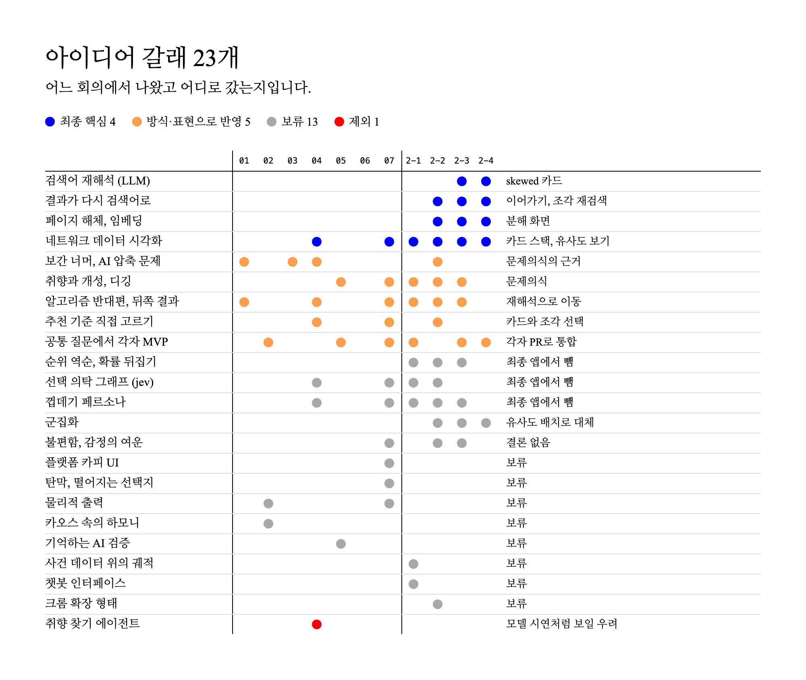

<sub>자동 전사를 Claude로 분류한 집계</sub>
